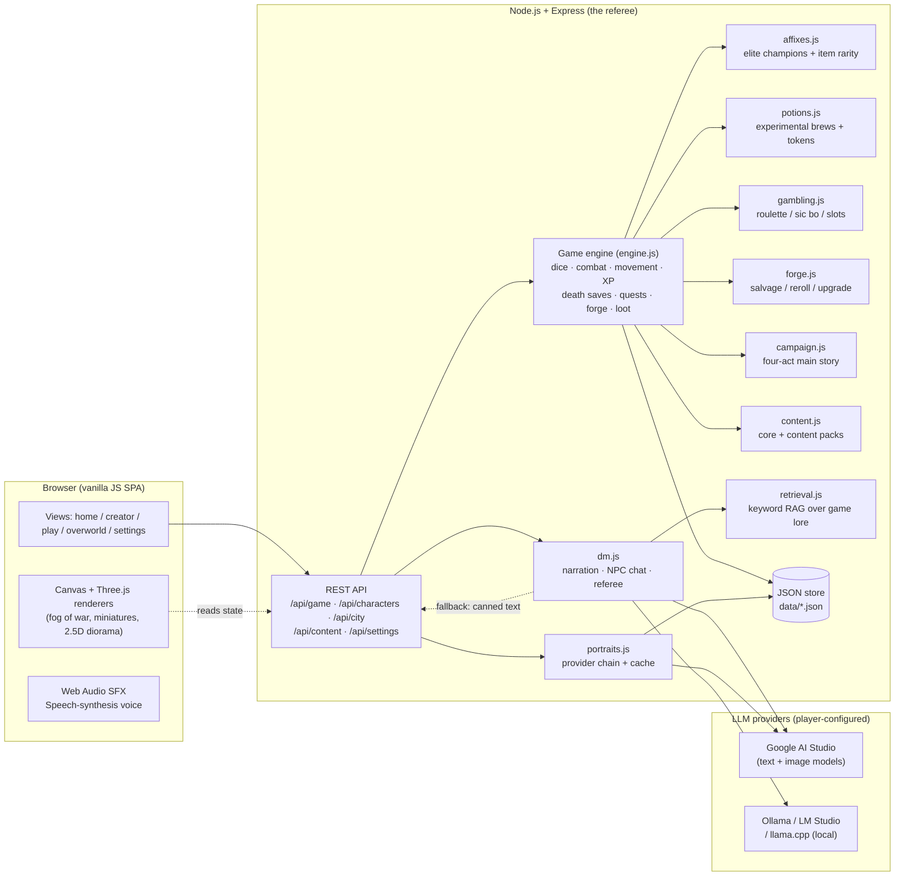
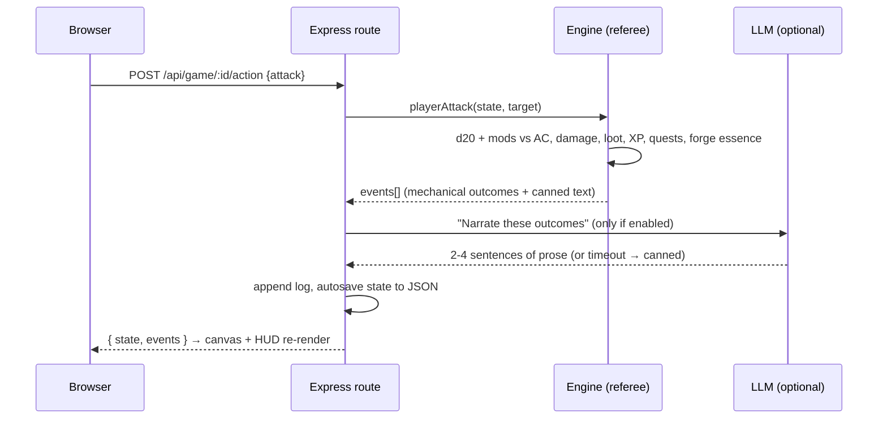

# 🏗 ARCHITECTURE — AI Dungeon developer & AI-collaboration handbook

Everything an AI (or human) contributor needs to make reliable changes: how the system works,
where every feature lives, the exact steps to extend each subsystem, and the checks that catch
mistakes before they ship. Ground rules, verification commands and the doc map live in
`AGENTS.md` (auto-loaded by AI coding tools; `CLAUDE.md` points at it) — this file is the deep dive.

First-time contributors: read [START_HERE.md](START_HERE.md), then the current summary in
PROJECT_STATE.md and your assigned specification in [tasks/README.md](tasks/README.md).
The current design direction is in [docs/GAME_DESIGN.md](docs/GAME_DESIGN.md).
The 2026-09-30 review found known gaps in start-option wiring (T1), asynchronous state writes
and narration persistence (T2), and whole-delve settlement idempotency (T3). T1 is done:
`api.startGame(characterId, options)` takes one explicit `StartGameOptions` object (JSDoc-typed,
tsc-enforced) and the prepare page / region dispatch / weekly trial all pass map, difficulty and
companion through. T2 now commits mechanics synchronously and merges model results into the
latest save. A follow-up review reproduced stale polling responses bypassing the client rev
guard and concurrent same-NPC chat history overwrites; those T2a boundaries are fixed. T3 (the
one-settlement-per-end contract) and the T3a boundary fixes (legacy endSeq baseline, stale-mirror
repair, keyboard/scripted navigation lock in the summary) are implemented and verified — see the
settlement bullet in §7 and `tasks/t3a-settlement-boundaries.md`. T4 (server-computed player
guidance: home/region-map next step, delve HUD objective and combat economy line, summary gains
and next objective) is done too — see the guidance bullet in §7 and
`tasks/t4-player-guidance.md`. The T4a boundary fixes (goal-obtained copy matched to the
engine's campfire-victory adjudication; `pickLiveSave` priority so a newer settled save can't
hide an active delve) are done too — see the guidance bullet in §7 and
`tasks/t4a-guidance-outcomes.md`. T5 (quick start: two server-defined preset heroes, one-tap
prepare-entrance routing, an observe-only skippable first-delve coach) is done — see the
quick-start bullet in §7 and `tasks/t5-first-adventure.md`. T7 (server-authoritative
lockbox/trap/road-encounter adjudication with faithful dice presentation) is done too — see the
T7 bullet in §7 and `tasks/t7-server-checks.md`. T8 adds two-phase content validation and
transactional imports (see below); T6 is implemented with validated scenes, persistent
narrative facts and two Vale Gate routes. T1–T8 shipped in 1.10.0.

Localization foundation (T9a): native ESM `public/js/localization/locale.mjs` is a pure
browser/Node contract; `en.mjs` / `zh-CN.mjs` contain only presentation text. CommonJS
`server/locale.js` dynamically imports the same contract; `/api` middleware negotiates
`X-Game-Locale` (explicit preference wins), then `Accept-Language`, else English. The value
is request-local `res.locals.locale`; `GET /api/locale` exposes it without writes. Existing
API bodies remain compatible and are not yet all localized. Do not set Content-Language
globally while legacy text remains untranslated.

Browser `i18n.js` owns `aiDnd.locale.v1` and `game:localechange`, with `t(key, params)`,
`translateDOM(root)` and `onLocaleChange(listener)` (returns unsubscribe). Locale aliases
normalize to zh-CN / en; a fresh browser follows its languages, otherwise English. Blocked
storage permits session-only use. `t` returns plain text; HTML insertion still requires esc.
Only text leaves carry data-i18n; do not replace controls or attach it to interactive parents.
SVG text must remain a native text leaf: bind data-i18n-display/fallback on the SVG
text element and escape the initial displayText value. Do not put HTML helpers such
as label/contentLabel/displayLabel (which emit span) inside SVG text: the HTML parser
can close the SVG early and move later waypoints outside the rendered map.
T9b extends that same contract with `label(key, params)` (escaped HTML for a text leaf),
`localizeText(element, read)` / `localizeAttribute(element, attribute, read)` (current-state
readers for busy/status text), and `displayText` / `displayLabel` for server `{key, params}`
descriptors. `data-i18n-params` carries plain interpolation values; option/SVG text uses a
text-only leaf, never a nested span. Attribute leaves include title, placeholder, aria-label
and alt. A live text binding stops updating after ordinary game code replaces its text.
View-owned `refreshLocalizedText` subscriptions release through cleanup; modal settings
also release on close/dispose and discard late initial loads. The shell translates body
modals in place. Language events never call navigate, renderSide/update, model requests,
save writes or renderer creation; they preserve busy/focus/input/selection/scroll and tabs.
The router gives every view an explicit `navigation` lifetime (`navigation.js`).
`isCurrent()` guards each asynchronous initialization boundary before DOM, shared-state,
sound, subscription or error publication. `onDispose()` registers idempotent cleanup even
before the first await; the next accepted navigation disposes that lifetime immediately.
Late view returns cannot replace the current cleanup, and returning to the same hash
creates a distinct lifetime. The settlement `ui:route-leave` veto runs first and retains
the existing lifetime when navigation is rejected. Rule loading is shared; late topbar
save-list responses also check the lifetime. Existing play/road identity guards remain.
Toast readers and API error getters resolve the selected language at display time.
Guidance, hero presets, difficulty, town/settings choices, check previews and fixed API
errors/results add display metadata beside legacy fields. Stage/availability decisions and
all numbers remain server/engine-owned. No save migration is needed. End-summary visibility
resets when mounting another delve; detached summary/check/level-up callbacks cannot paint
over a newer panel. Regression tests cover two consecutive adventures in one browser.
Canonical IDs, className, item uniqueId and numeric rules never become translated inputs.
T10 reuses that view with a persisted `dnd_delve_layout` preference (map-first by default,
or tactical). The former immersive toggle / V select the same layout. A view-owned
`play/panel-manager.js` moves the existing side/quest/log nodes into one drawer; chat
input nodes and the renderer survive every toggle. Core action/economy/target controls
move with their original event handlers, and server guidance remains the objective source.
The top HUD lays out health, guidance, initiative, encounter controls and the existing
tutorial in flow, so a new objective or a long translated hint cannot cover another strip.
`modal.js` coordinates the existing inventory, scene, check, journal, summary, settings
and level-up factories using cancelable presentation events and focus restoration.
Settlement confirmation controls the view-wide navigation lock: links, Escape, tool
shortcuts and the router's cancelable `ui:route-leave` boundary cannot abandon a pending
or failed bank operation. View cleanup removes the manager/keyboard/visualViewport
listeners and disposes the existing renderers; it does not dispatch game actions.
The 3D renderer observes its container, preserves camera target/zoom across resize,
keeps the pixel ratio cap of 2 and pauses drawing when hidden in 2D mode. Its observer
disconnects on idempotent dispose, which also releases its WebGL context. 2D clicks continue
to use the live canvas rect. Read-only renderer/observer counters support lifecycle checks.
Mobile drawers use safe areas and visualViewport bounds for the virtual keyboard;
map/HUD/drawer/pause/blocking-modal layers are explicit in the single T10 CSS block.
L1 adds a horizontal desktop town workspace with separately scrolling catalog and
dispatch sidebar. `region-map.js` measures the existing SVG viewport, keeps text and
vector targets screen-sized, and displaces crowded presentation positions/labels;
authored coordinates and stable IDs are unchanged. Locale changes refresh the same
native SVG nodes; long names use native tspan/title, never HTML inside SVG. Its observer
and the town header-height observer disconnect through view cleanup. Public destinations
add an enum `marker` for these vector symbols while retaining the legacy glyph `icon`.
`fullscreen.js` owns explicit Fullscreen API controls for town/play. The target is the
documentElement, including body-mounted dialogs, and fullscreenchange updates controls.
V and the layout preference remain independent. Request rejection reports a localized
toast; cleanup removes listeners and exits owned fullscreen, with identity checks so
an old delayed request cannot exit a newer view's fullscreen. No presentation operation
dispatches an engine action or recreates WebGL. See `tasks/l1-landscape-fullscreen.md`.
Desktop long story objectives use a two-line HUD summary; full prose and choices remain
in the existing scrolling modal. Native browser Escape exits fullscreen first, leaving
the current blocking modal available for its own close/Escape lifecycle.
V1a isolates creature visuals behind `visual-instance.js`: root, sync, move, update,
play, motion/state and idempotent dispose. `map3d.js` owns semantic tile/entity IDs,
paths and raycasting, and never reads a procedural rig or HP sprite. The default
adapter preserves `models3d.js`; `visual-sample.js` demonstrates a jointless hero and
monster with private action clocks/resources. Instance-owned textures, materials and
geometry are released on removal, replacement, board transition and view cleanup;
Sprite's shared quad is cloned before ownership. Invalid synchronous factories fall
back to the default, while rejected async results are disposed without scene attachment.
Confirmed explicit player attack responses trigger one visual action using save ID
and accepted revision, never localized prose or polling. Missing actions retain idle/
walk, with no gameplay delay. First stage has no package, loader, binding persistence
or management UI; see `tasks/v1a-visual-instance.md` for the code-only sample seam.
T9c (done) adds optional `localized: {en: {...}, 'zh-CN': {...}}` on definition
nodes. Only existing string fields or string arrays may be overridden; translations
cannot introduce mechanics, IDs or references. The validator checks locale tags,
field existence, value shape and matching interpolation parameters. Presentation
adds `*Display` descriptors to cloned, already-authorized API data. Hidden rooms,
author NPC knowledge and unchosen scene outcomes are never translation payloads.
Engine events receive explicit messageKey/params at creation while retaining legacy
text. Old text-only history is displayed verbatim and marked as historical; there is
no full-text matching or save rewrite. Model task locale is captured at request entry.
`resolveDisplay` handles a key/messageKey with params, localized text with a canonical
fallback, or ordered parts with a separator. `presentation.js` clones API output using
JSON serialization (matching res.json, excluding legacy engine callbacks) and only
attaches metadata after `sanitize` determines visible prose. Attack name descriptors
resolve weaponId against that character's own inventory, including rolled unique IDs.
It never changes
the registry or consumes RNG. Pack exports bypass presentation so their canonical
bundles can roundtrip through T8. Rolled gear is rendered from existing base/affix/set
IDs and stored bonuses; uniqueId remains the equipment reference. Coverage and the
creation-site migration list are in `docs/T9C_LOCALIZATION_COVERAGE.md`.
AI caches use locale:type ID keys with the legacy cache alias retained. Generated
log/chat/journal text carries language and actionId (aid); late results only merge
their own fields into the latest save. Retrieval selects discovered rooms/monsters,
owned items and the speaking NPC's knowledge, using Han bigrams as well as Latin
terms. TTS matches the body's language; unavailable voices stay silent. A locale
change cancels pending audio without requesting a replacement model response.
T9b covers fixed UI; T9c covers authored stories, rule entity names/descriptions,
event/log text, historical-text compatibility and AI/TTS narration. Never infer translations
by full-text replacement or use language switching to rebuild a view.

Content validation (T8): `server/game/content-validation.js` is a pure JSON validator with no
engine imports. `content.scan` checks and normalizes fields, registers core → shipped → installed
definitions, then resolves references across the complete registry. Invalid dependencies are
removed transitively. Within each pack root, folder names are sorted; duplicate diagnostics carry
the winning source. Core's `dire_wolf` remains effective. `scan({cache:false})` leaves the live
registry untouched; import dry-runs use the same folder order as actual installation.

M1 public destinations: `content.adventureDirectory()` compiles `adventures/waypoints/roads`
from effective authored map definitions and `adventure-system.js`'s town/endless/weekly
entries. `/api/content` exposes these fields and retains the legacy `maps` summaries;
`/api/city/info` reloads the same registry and exposes `adventures/mapNodes/mapRoads`.
The projection explicitly selects public name/blurb/recommendation/source and their
text descriptors; it never copies rooms, NPCs, scene effects, private knowledge or a
raw localized tree. The old maps API retains public objectiveText and whitelisted
translations. Injected procedural floors have no author provenance and never become
additional catalog entries. System destinations and engine map IDs remain unchanged.
Optional map `adventure` metadata is limited to descriptive `levels` and a public
`waypoint` (`regionX/regionY` percentages, enum icon, region text, finite roads). Its
ID is the map ID; roads reference another validated positioned map or positioned
system endpoint, with one declaration per undirected pair. T8 checks fields, bounds,
reserved system IDs, duplicates and dependencies before transactional install, and
rejects replacements that remove a required endpoint. New metadata exports in the
existing bundle; active map snapshots and settlement receipts are not rewritten.
Shipped positions now live in map files; the city route has no static map table or
courier special case. The safe town hub draws first, then adventure waypoints draw
in stable geographical order instead of pack scan order, preserving the legacy
overlapping markers' hit priority.
`public/js/adventure-directory.js` shares search, source filtering, selection and
original-language hints between town and prepare. Reload preserves filters and
selects a current destination when one disappears. The owner view's single locale
subscription translates/refilters existing controls; the component aborts its DOM
listeners on dispose. It never creates a renderer or calls a game action. Town still
uses T7a's guarded road/embark flow; prepare submits the same explicit start options.

`GET /api/content` retains text `warnings` and adds structured `diagnostics` (`severity`, `code`,
pack/file/field/message). `GET /api/content/validate` checks the registry; `POST /api/content/validate`
checks an import bundle without writes. `POST /api/content/import` rejects fatal errors before
writing and rejects replacements that break previously valid dependencies. A valid replacement
is staged under DATA_DIR/.content-imports outside the scanned content root, then renamed into
place with a backup for rollback. Obsolete pack files disappear. If rollback itself fails, the
backup is retained and its path reported. This synchronous transaction has no model waits.

`getMap` defaults only when no selection is supplied; unknown/invalid explicit IDs return null.
The start route rejects them before consuming prizes/boons or saving; engine start/travel also
guard missing maps and invalid arrival coordinates. Trusted procedural maps still use `injectMap`;
they are not imported JSON packs. Legacy victoryTile, inferred dimensions and empty collections
remain supported, and unknown author fields survive normalization. Reachability is a warning
under optimistic door/destructible/monster assumptions, not a proof of playability.

Map entities may explicitly override a monster definition's `boss` boolean; hydration, elite
eligibility and slay_boss validation all use that effective flag. NPC marker objects retain npcId,
so an otherwise valid canned NPC interaction cannot crash during hydration. T8 also repairs
wall-bound actors/chests/spawns and noncanonical campfire IDs in the shipped howling-hills and
Sunlit Vale maps; stats/loot tables are unchanged. New map data applies to new delves; existing
save snapshots are not rewritten. The complete example is
[minimal-pack.json](tests/fixtures/content/minimal-pack.json); rules and author workflow are in
[MODDING.md](MODDING.md), and the read-only checker is `scripts/check-content.mjs`.

## 1. The big picture

Automated verification uses `npm run verify` → `scripts/docker-verify.mjs` → `Dockerfile.test`.
The dedicated Linux container owns the server, all tests and Chromium (required WebGL2 via
SwiftShader). It has 2 CPUs / 4 GiB RAM, network disabled and fresh temporary test data;
only per-run artifacts are mounted. The fixed Docker name serializes full runs across agents.
The container executes the real `npm run verify`, exits with its result and is removed on all
normal/failure/timeout paths. MCP and CI share the same entrypoint; see [Docker testing](docs/DOCKER_TESTING.md).

One Node.js process serves everything. There is no cloud: the game state lives in local JSON
files, and every AI feature talks to *whatever* OpenAI-compatible endpoint the player configures.



**The core rule: the engine decides, the LLM describes.** Dice, damage, XP, loot, forge odds,
gambling payouts, brew effects — all resolved deterministically by the engine. The LLM only
receives *resolved outcomes* and writes prose. If the LLM is off, slow, rate-limited or
hallucinating, the game keeps working from baked-in text. That is why the game is 100% playable
offline and the AI can never cheat.

## 2. One player action, end to end



Every action (move, attack, cast, interact, freeform text) flows through the same dispatch. The
referee (`server/game/referee.js`) and bounded action engine (`server/game/bounded-actions.js`, T13a)
map freeform player text in English and Chinese onto *real* mechanics — "I listen at the door" becomes a
Perception check, and "我把治疗药水给里奥" becomes the authoritative scene choice `aid` with real potion deduction.
The retrieval layer feeds the DM real lore so flavor text can't contradict the world.

### Bounded Natural Actions (T13a)
Freeform natural language actions are strictly constrained to five bounded categories with authoritative reach:
1. **Investigate visible objects** (`investigate`): visible/discovered objects within Manhattan distance <= 2.
2. **Chat with reachable NPCs** (`chat`): visible alive NPCs within distance <= 4.
3. **Use owned items** (`useItem`): items present in player's inventory with quantity > 0.
4. **Current legal scene choices** (`sceneChoice`): pending scene choices whose speaker is adjacent (distance <= 1).
5. **Basic attacks** (`attack`): visible alive monsters within melee (<= 1) or ranged weapon range.

**Security & Concurrency Lifecycle**:
- Model wait outside lock: LLM proposal generation occurs outside `withSaveLock`.
- Re-verification against latest snapshot: when acquiring lock, proposal is re-validated against `latest` save state (checking hero consciousness, combat turn, reach, and item availability).
- Authorized context only: prompts receive strictly visible entities/choices; fog-of-war, hidden traps, and future narrative branches are never exposed.
- Clarification: multiple eligible targets emit `{ type: 'clarification' }` without preliminary resource spend.
- Confirmation: irreversible choices or gold costs emit `{ type: 'confirmation' }` requiring player approval.
- Compound inputs: a single sentence executes at most one mechanical action.
- Backward compatibility: 100% legacy keyword support (`hide`, `rest`, `shove`, `disarm`, `listen`, `dodge`, `disengage`, `quest`).
- One executor, not two rulebooks: `server/game/action-executor.js` is the only place turn ownership, the
  action/bonus slot, item instance and quantity are decided. The button route, the bounded proposal executor and
  the legacy referee all call it, so a sentence can never be cheaper than the click, and nothing re-implements
  deduction or rolls damage outside it (nor does the server HTTP-loop back to itself).
- Candidate visibility is the engine's own rule: the model's context filters objects through
  `engine.isObjectVisibleToPlayer` (an unspotted trap is invisible even on an explored tile) plus
  `isTileDiscovered`, fog/line-of-sight for monsters and the 4-tile rule for NPCs, and drops choices whose
  `history_ending` gate the hero has not earned. A general search may still stumble onto a hidden trap later,
  but the proposal model never receives its id, name, type or position beforehand.

## 3. Where every feature lives

### Game systems (engine)

| File | What it does | How to extend it |
|---|---|---|
| `server/game/engine.js` | The referee: dice, combat, movement, fog of war, XP, death saves, conditions, buffs, quests, loot, rests, hazards, traps, doors | Add a function, export it from `module.exports` |
| `server/game/bounded-actions.js` | T13a bounded natural language actions: authorized context extraction, deterministic Chinese/English parsing, strict proposal validation, ambiguity clarification, cost confirmation and authoritative execution. | Extend dictionary patterns in `parseDeterministicAction` or validation rules |
| `server/game/affixes.js` | Elite champion affixes (blazing / stone-skinned / vampiric / venomous / storm-charged) + procedural magic-item rarity tiers + item sets (`ARMOR_SETS`: 25% of armour-pool rolls carry a set tag; 2pc/3pc tiered AC + initiative, resolved live by `engine.setAcBonus`). `buildAffixItem()` is the single assembly path shared by loot and the forge. | Add a row to `MONSTER_AFFIXES`, `WEAPON_AFFIXES`/`ARMOR_AFFIXES`, or `ARMOR_SETS` |
| `server/game/potions.js` | Three tiers of experimental brews (effect rolled at purchase, hidden until identified). `DELVE_TOKENS` for gambling prizes. Effects are built from buff ids the engine already reads. | Add a row to `POTION_EFFECTS` or `DELVE_TOKENS` |
| `server/game/gambling.js` | Roulette / sic bo / slot machine. Every table is split into a pure evaluator (`evalRoulette` etc.) + a spinner. Odds verified by exhaustive enumeration in tests. | Edit a paytable; run `tests/unit/gambling-and-potions.test.mjs` to see the new house edge |
| `server/game/forge.js` | Salvage gear into ember essence; reroll affixes; upgrade rarity. Items rebuilt through `affixes.buildAffixItem`. | Edit `FORGE_COSTS` or `SALVAGE_ESSENCE` |
| `server/game/campaign.js` | Four-act main story state machine (Relic → Vault Key → three clues → the Ember Queen). `advance()` is order-checked and idempotent. | Edit `ACTS` to add or change story beats |
| `server/game/guidance.js` | Deterministic next-step copy (T4): `journey()` for home/region map/summary, `delve()` for the HUD objective and combat economy line. No LLM, no RNG, no leaks. | Edit the templates/`MAP_NAMES`; field contract in §7 |
| `server/game/presets.js` | T5 quick-start recommended heroes (melee guardian + caster arcane): client-facing metadata (`listPresets()`) plus the `buildCharacter` drafts (`draftFor(id)`). The client only ever sends `presetId` + optional name. | Edit a preset's draft/copy; run `tests/integration/quick-start.test.mjs` — it rebuilds both through the real engine rules |

### Routes (HTTP layer)

| File | Endpoints |
|---|---|
| `server/routes/game.js` | `/start` (refuses an unresolved road encounter, T7a) · `/:id` (get) · `/:id/preview` (read-only deterministic check previews, T7a) · `/:id/action` (the big dispatch: move, attack, cast, useItem, equip, rest, freeform, chat, buy, retreat, respawn…) |
| `server/routes/characters.js` | CRUD (creation accepts `presetId` for the T5 quick start — the preset draft wins over client fields, the response carries `guidance`) · `/level-up` · `/equip` · `/portrait` · `/road-encounter` (fixed outcome table; delve-scoped boons ride as `pendingRoadBoons`) |
| `server/routes/city.js` | `/info` · `/rest` · `/buy` · `/sell` · `/gamble` · `/forge` · `/identify` · `/claim-bounty` · `/sync-delve` · `/hall-of-heroes` · `/campaign` · `/rumor` |

### Frontend (vanilla JS SPA, no build step)

| File | What it does |
|---|---|
| `public/js/app.js` | Hash router + shared helpers (`esc`, `toast`, `loadRules`) |
| `public/js/views/play.js` | The delve screen entry: map render, action dispatch, combat HUD, side panel (`renderSide`/`combatHud`/`wireSide` stay here by design — the level-up handler reassigns `game` itself) |
| `public/js/views/play/panels.js` | Delve panels extracted from play.js: shop / journal / skill-check / end-of-delve summary (`createPanels(ctx)`) |
| `public/js/views/play/tutorial.js` | T5 first-delve coach: a floating card (move → interact → combat → settle) that only observes server state/events; skippable, once per install (`createDelveTutorial()`) |
| `public/js/views/play/ribbon.js` | The tactical initiative ribbon (`renderInitiativeRibbon(game, onSelectTarget)`) |
| `public/js/views/play/delve-inventory.js` | The in-delve backpack & equipment modal (`createDelveInventory(ctx)`) |
| `public/js/views/overworld.js` | Region map + town hub entry: routing, header/map events, district switch |
| `public/js/views/overworld/districts.js` | The six district renderers + their events + gambling state (`createDistricts(ctx)`) |
| `public/js/views/overworld/road-encounter.js` | The road-encounter modal (`showRoadEncounterModal`) |
| `public/js/views/campaign.js` | The four-act main story panel + epilogue |
| `public/js/views/levelup.js` | Interactive level-up wizard (HP / subclass / ASI / spells) |
| `public/js/map3d.js` | Three.js 2.5D diorama (camera, walking miniatures, exit beacon) |
| `public/js/map.js` | 2D canvas renderer + minimap |
| `public/js/models3d.js` | Procedural articulated miniatures (heroes, monsters, walk cycles) |
| `public/js/tooltip.js` | Universal hoverable item/monster tooltips (JSON payload for rolled gear) |
| `public/js/entity-visibility.js` | Shared board visibility + camera smoothing (pure, testable) |
| `public/js/dice.js` | Animated dice overlay (`rollAnimated`, `showDice`) |
| `public/js/sfx.js` | Web Audio synthesized SFX + ambient loop |
| `public/js/tts.js` | SpeechSynthesis voice-over (chunked, optional Piper) |

## 4. How to add things (cookbook)

Each recipe is the exact steps, in order, with the checks that must pass.

### Add a new player action

1. Add a `case 'search':` to the action dispatch in `server/routes/game.js` (the big switch).
2. Implement the logic in `server/game/engine.js` (e.g. a `searchRoom(state, events)` function).
3. Push events with `{ type: 'search', narrate: true, text: '...' }` so the LLM can narrate it.
4. Add a button or hotkey in `public/js/views/play.js` → `act({ type: 'search' })`.
5. Add the event type to `SFX_MAP` in `play.js` if it needs a sound.
6. Add an assertion to `tests/integration/combat.test.mjs` or a new integration test.

### Add a new elite affix or magic-item affix

1. Open `server/game/affixes.js`.
2. Add a row to `MONSTER_AFFIXES` (for champions) or `WEAPON_AFFIXES`/`ARMOR_AFFIXES` (for gear).
3. Run `npx eslint server/game/affixes.js` and `node tests/unit/affixes-and-loot.test.mjs`.

### Add a new experimental brew effect

1. Open `server/game/potions.js`.
2. Add a row to `POTION_EFFECTS`: `{ id, kind: 'good'|'mixed'|'bad', weight, name, desc, apply(ctx) }`.
3. The `ctx` has `{ engine, state, char, p, events, roll, tier }`. Use buff ids the engine
   already reads (`longstrider`, `blessed`, `brew_fortune`, `divine_favor`, `poisoned`…),
   `engine.adjustTempHp` for max-HP swings, `engine.blockRest` for a lost rest.
4. Run `node tests/unit/gambling-and-potions.test.mjs` — every effect is tested.

### Add a new gambling game or change a paytable

1. Open `server/game/gambling.js`.
2. Add or edit the evaluator (`evalRoulette` / `evalSicBo` / `evalSlots`) — the pure function.
3. Add a spinner wrapper if the game needs randomness.
4. Run `node tests/unit/gambling-and-potions.test.mjs` — it verifies the house edge by
   exhaustive enumeration and will report the new return-to-player percentage.

### Add a new campaign act

1. Open `server/game/campaign.js`.
2. Add a row to `ACTS`: `{ id, act, name, icon, mapIds, mapName, objective, blurb, reward }`.
3. Make sure `mapIds` reference real content maps (`content.getMap(mapId)` must return a map).
4. The advance / objective / epilogue logic adapts automatically.

### Add a new content pack

See `MODDING.md` for the full pack format. Drop the folder under `content/<your-pack>/`,
open a PR, and it ships with the game.

## 5. Data shapes (the contracts between engine, routes and views)

These are the shapes that cross the serialize boundary (`state` → JSON → browser). If you change
them, update the client views and the tests in the same commit.

### Game state (the `state` object, serialized per delve)

```
state.id                    save id ("save_xxx")
state.characterId           roster character id
state.rev                   bumped on EVERY persisted write — the client rejects whole-state
                            snapshots older than what it already shows (T2 aux-response guard)
state.character             deep copy of the hero (inventory, equipped, attacks, slots, uses…)
state.character.essence     ember essence earned in this delve (synced to roster on settle)
state.mapId / mapName / map
state.mode                  'explore' | 'combat' | 'victory' | 'retreat' | 'over'
state.difficulty            'easy' | 'normal' | 'hard'
state.entities[]            player + allies + monsters (alive, hp, position, conditions, buffs)
state.objects[]             doors, chests, barrels, traps, hazards, campfire, stairs
state.flags                 hasRelic, altarBlessed, victory, failed, restsBlocked, used_*, room_*
state.quests                { active, completed[] }
state.stats                 { dmgDealt, dmgTaken, kills, goldFound, rounds }
state.discovered[]          fog-of-war tile keys ("x,y")
state.world{}               per-map snapshots (monsters, objects, discovered, room flags)
state.journal[]             AI-DM journal entries
state.log[]                 mech + dm + player log lines
state.campaign              main-story progress (see campaign.js)
state.levelUp               server-computed verdict for the HUD badge (see engine.levelUpInfo)
```

### Inventory item (plain vs rolled)

```
Plain:  { itemId: 'potion_healing', qty: 2 }
Rolled: { itemId: 'longsword',                    ← base item for lookups
          uniqueId: 'affix_keen_longsword_…',     ← stable identity (equip target)
          name: '锋锐之长剑', rarity: 'magic',      ← display name + tier
          affix: 'keen', magic: 1,                ← affix id + enhancement bonus
          bonusDamage: {dice,type}|null, vampiricHeal|null,
          acBonus|null, hpBonus|null, speedBonus|null,
          cost, desc, qty }
Brew:   { itemId: 'potion_mystery_thin', uniqueId, kind: 'mystery_potion',
          tier: 'thin', identified: false, effect: { id, kind, name, desc },
          clues: ['气味…', '颜色…', '挂壁…'], qty: 1 }
Token:  { itemId: 'token_luck', uniqueId, kind: 'delve_token', delveOnly: true,
          tokenId: 'luck', name, desc, qty: 1 }
```

`delveOnly: true` items ride into one delve (`startGame` via `carryItems`) and are discarded at
settlement (`sync-delve` filters them out).

### Entity (on the map)

```
{ id: 'player' | 'ally_bram' | 'monster_3', kind: 'player'|'ally'|'monster'|'npc',
  x, y, hp, hpMax, ac, speedFt, alive, aware, fled,
  conditions: ['poisoned', …], buffs: [{ id, rounds, condId?, … }],
  attacks: [{ name, bonus, damage, damageType, range }],
  monsterId (monsters), affix (elite champions), boss (bool),
  loyalty (allies: 0-100 morale, seeded from char.companionLoyalty[allyId]) }
```

## 6. Checks that run on every push (CI)

| Step | What it catches |
|---|---|
| `npx eslint .` | Duplicate declarations (the campfireOf bug), unused variables that used to be live wiring, undefined identifiers (the `char` crash) |
| `npx tsc --noEmit` | Type mismatches via JSDoc + checkJs (missing fields, wrong argument counts, `undefined` reads). server/ **and all of public/js** are covered — the include list is a glob, so new files are checked automatically. The vendored Three.js import is mapped by `paths` to the permissive stub `public/js/vendor-three.d.ts`; shared window/document expandos live in `public/js/globals.d.ts` |
| `node scripts/smoke-test.mjs` | End-to-end API chain: health → character → delve → shop → gamble → brew → forge → campaign → movement → combat → content packs |
| `node scripts/test-all.mjs` | 42 suites inside the dedicated verify container: environment gates, core unit/integration checks, T6/T8/T9a/T9c/T11, review HP, M1 directory and V1a visual ownership checks; 15 required Chromium CDP suites including review regressions, M1 roundtrip, L1 landscape/native fullscreen and V1a confirmed actions/lifecycle. See scripts/test-all.mjs for the actual list. |

**Both `eslint` and `tsc` must pass with zero errors.** If you add a file with `// @ts-nocheck`,
that is a deliberate opt-out — remove it as soon as the file is ready.

## 7. Known quirks (don't re-introduce these)

- **Same-save write contract (T2).** Every mutation of a delve save is a synchronous
  read-modify-write of the LATEST file (`store.getSave` → mutate → `store.saveGame`, no
  awaits in between — atomic in the event loop). Model/LLM waits NEVER happen while holding
  a snapshot: the action route queues them into `pending`, runs them outside any lock with
  the saved snapshot as prompt context only, then merges back **only their own fields**
  (log lines, journal, `appearances`, chat history, quest text) onto a freshly-read state.
  Narration is stamped with an `actionId` (`log[i].aid`) and merged by `applyNarration`
  (canned lines of that action are dropped, the DM prose is appended once — dedupe by aid).
  Never add an await between `getSave` and `saveGame` in `routes/game.js` — that gap is
  exactly the bug where a slow `describe` rewound the player's position. `store.withSaveLock`
  serializes the async merge phases; it must never be held across a model request.
  On the client, `adoptState` in `play.js` is the single gate for adopting a whole server
  state: it rejects a different save's snapshot (`next.id !== game.id`) and anything older
  than the shown `rev` (equal rev is fine — a fresh GET of the same save). The 4s poll, the
  level-up GET and the action/aux responses all go through it; the poll callback also checks
  `viewAlive`, and every playView mounts under a `viewToken`, so a response that lands after
  the view ended (or after a newer view mounted) is dropped — the initial GET in `playView`
  is the only direct assignment (initialization boundary). Chat history is merged per
  action: each chat appends exactly its own aid-tagged user/assistant pair onto the latest
  save's `npcChat[npcId]` in completion order (24-entry cap, dedupe by aid) — never copy the
  prompt snapshot's whole history over it. The portrait cache lives in a module-level
  `portraitCache` (server snapshots never carry client-side caches).

- **One settlement per ended delve (T3, boundaries fixed in T3a).** `POST /api/city/sync-delve`
  settles an ENDED delve
  (mode `victory` / `retreat` / `over`) exactly once. The settlement identity is
  `<saveId>#<endSeq>` — `endSeq` is stamped by the engine every time a delve ENTERS an end
  state (engine death, `checkVictory`, and the route's `retreat` case; respawn keeps the
  counter so a second death settles again as `#2`). It is deliberately NOT `rev`: narration
  and auxiliary writes keep bumping `rev`, and must never mint a second settlement. Legacy
  end-mode saves that predate the counter get `endSeq = 1` baselined by the store migration
  ON READ (they settle as `#1`, and the next real end after a respawn becomes `#2` instead of
  colliding with the old receipt) — re-deriving the baseline per read means a failed mirror
  write cannot lose it. The
  receipt (`{ id, ts, mode, mapId, mapName, gold, xp, level, delveNumber, campaignAdvanced,
  weeklyWin }`) lives on the roster (`char.settlements`, capped at 100) — that copy is the
  authority, written FIRST; if the roster write fails nothing is persisted anywhere and the
  retry re-processes from the untouched delve snapshot. The delve save mirrors the receipt
  on `state.settled` (best-effort, after the roster): a replayed request returns the same
  receipt with `duplicate: true` and touches nothing, a roster restored without its receipts
  dedupes from the mirror (and heals its receipt list), and the duplicate path heals the
  mirror when it is MISSING **or STALE** (an older settle's mirror that survived a failed
  newer mirror write is repaired to the current receipt). Validation happens before any
  mutation: unknown hero/save → 404, a save
  owned by another hero → 403, a not-ended or snapshot-less delve → 400 — the old no-save
  incremental path (`goldGained`/`xpGained`/`newItems` from the request body) is REMOVED, it
  had no caller left and trusted client numbers as authoritative rewards. The summary panel
  (`play/panels.js`) shows saving/saved/failed and keeps the return links and respawn locked
  until the settle is confirmed: `.btn.locked` (pointer-events) covers the mouse, and a click
  guard plus `aria-disabled`/`tabindex="-1"` covers real Enter keys, assistive tech and
  scripted `.click()` calls; the gold row only says "banked" after the server confirms.
  Review/close/backdrop stay usable while locked, and a failure offers a retry.

- **Server-computed player guidance (T4).** `server/game/guidance.js` is the single source of
  the "what now?" copy — deterministic templates, no LLM and no RNG, so the loop stays
  playable with AI off. Two functions, two shapes, both additive on existing payloads:
  - `journey(char, { liveSave })` rides `/api/characters` (per hero), `/api/city/info`,
    `/api/city/campaign` and the `sync-delve` response. Fields: `stage`
    (`unsettled` | `in_delve` | `preparing` | `complete`), `label` (campaign progress),
    `objective` (the campaign's public objective), `primary` (`{ kind: 'resume'|'prepare'|
    'map'|'campaign', saveId?, mapId?, text, reason }`) and a small `options` list.
    `pickLiveSave` picks what the primary action continues, by priority (T4a): an
    ended-but-unsettled delve first (spoils must not be lost), then a RUNNING delve
    (explore/combat — a newer settled end must not hide an older active one), then the most
    recent save (a settled one; journey treats it as "no active delve" and points at the
    next story step). Settled is decided by the roster receipt OR the matching mirror
    (T3 authority rules — a lost mirror doesn't fake an unsettled delve, and a mirror that
    matches neither the save's endSeq nor any receipt proves nothing). Within a group the
    newest `updatedAt` wins. The client only maps actions to
    hash routes (`#/play/<id>`, `#/overworld?char=…&node=<mapId>`, `#/campaign/<id>`); every
    real action is still validated by its own route on submit — guidance can never change a
    game result or auto-embark/spend.
  - `delve(save)` rides `sanitize` as `state.guidance`. Fields: `stage` (`explore` |
    `objective` | `cleared` | `combat` | `victory` | `retreat` | `defeat`), `objective` (the
    HUD pill line), `hint` (hover-bar default copy)
    and, in combat, `combat` (`{ yourTurn, movementLeftFt, action, bonus, potions, notes }`)
    — the economy line spells out which action is spent and why (the client renders it as
    `.guidance-combat-line`; the disabled buttons' title tooltips stay for hover). The copy
    must match the engine's actual adjudication (T4a): `objective` (goal in hand, still
    explore) sends the player to WALK ONTO the campfire tile — that is what fires
    `checkVictory`, the story advance and the victory reward; an entrance/campfire retreat
    is legal but only settles current spoils and never advances the story, so both the
    guidance and the retreat button say so. `cleared` (no living monsters, goal pending) is
    NOT a completion — it offers continue-or-retreat with `returnPrompt: false`.
  - Leak rules: copy comes only from static map metadata the player already sees (map names,
    `objectiveText`) and the campaign objective — never coordinates, undiscovered entities,
    trap positions or loot tables.
  - New default copy is Simplified Chinese (proper names kept). Home cards, the region-map
    banner/sidebar ("📜 主线推荐" + reason), the delve HUD and the summary all render the
    server text; the summary additionally shows the settle receipt's `gains`
    (`{ gold, xp, levels }` — the real delta vs the pre-settle roster) and folds the raw
    statistics into a `<details>`.
  - `store.listSaves()` carries `mapId` / `mode` / `endSeq` / `settled` so guidance can tell
    a running delve from an ended-unsettled one from a settled one without extra reads.

- **Quick start & first-delve coach (T5).** Two additions that must stay server-owned and
  observe-only:
  - Presets: `server/game/presets.js` holds the two recommended hero drafts (melee
    `guardian`, caster `arcane`). The home quick-start card renders ONLY the server
    metadata from `/api/rules` (`presets`) and POSTs `{ presetId, name }`; `POST
    /api/characters` resolves the draft via `presets.draftFor()` and builds through the
    real `engine.buildCharacter` — the preset always wins over client-sent fields, an
    unknown `presetId` is a 400, and an empty name falls back to the preset default. The
    POST response additionally carries `guidance` (same shape as GET /) so the client can
    route to the recommended prepare entrance (`?node=<mapId>`) without deriving story
    state client-side — it still never auto-embarks. Known creation gap kept out of the
    presets: `buildCharacter` ignores speciesChoices for skills, so preset drafts pass
    species picks as `draft.skills` (do not "fix" the drafts, fix buildCharacter).
  - Coach: `public/js/views/play/tutorial.js` (`createDelveTutorial`) renders a floating
    card driven by move → interact → combat → settle. Steps advance ONLY from adopted
    server state (player position, `mode`, `stats.kills`, the `settled` mirror) or the
    server's own action response (an `interact` — or a T7 `skillCheckObject` — without an
    `error` event); it never sends actions and never reads client-side rolls. One-time per
    install via localStorage `aiDnd.tutorial.v1` (`active`/`done`/`skipped` + done list —
    a reload resumes the current step instead of restarting, done/skipped never shows
    again). play.js wiring is six lines: create after panels, `maybeStart` after first
    render, `observe` from `update()`/`act()`, `destroy` in the view cleanup.

- **Client display boundaries found by the T5/T7 integration browser run (don't re-introduce)**:
  - The crypt's altar and relic share tile (12,22); a first-match object lookup shadowed
    the relic forever and made the stage-0 objective unclickable in the UI (API-level
    tests and the replay bot never render, so this hid for the whole project). The click
    path in play.js now cycles through the objects on a repeatedly-clicked tile
    (`tilePick`); targeting only — the server still adjudicates by `objectId`.
  - A natural-1 death save adds TWO failures, so a hero can die at `deathSaves.fail = 4`;
    rendering `'○'.repeat(3 - fail)` then threw `Invalid count value: -1` and bricked the
    delve view on every reopen. The side-panel death-save display now clamps counts to
    [0, 3].
  - Respawn exists twice (the summary panel's button and the side panel's `data-act`
    button). Both must reset `summaryShown`, or the NEXT end state (victory/death/retreat)
    never auto-opens its settle summary and the player has no UI path to settle it.
- **Server-authoritative skill checks & road encounters (T7)**:
  - **Chest and trap checks**: `server/routes/game.js` (`skillCheckObject`) delegates strictly to `engine.unlockChest(state, obj, method, events)` and `engine.disarmTrap(state, obj, events)`. Client-sent `rollTotal` is completely ignored. Engine checks enforce thieves' tools requirements (`thieves_tools` or `tool_thieves` in inventory for lock picking and trap disarm; athletics for lock forcing), roll d20 using engine RNG (supporting rogue retry/advantage), mutate object states (`unlocked`, `disarmed`, `triggered`), and emit `chest_unlocked`/`chest_locked` or `trap_disarmed`/`trap_disarm_failed` events with payload `{ objectId, method, natural, modifier, total, dc, outcome, success }`.
  - **Animated dice presentation**: `public/js/dice.js`'s `rollAnimated(sides, label, fixedResult)` accepts the server's `natural` die roll. The client UI disables action buttons, dispatches the action to the server, and uses `ev.data.natural` for visual dice animation so the presentation always faithfully reflects the server's adjudication.
  - **Road encounters (T7 + T7a lifecycle)**: Server tracks the live instance on `char.currentRoadEncounter = { id, instanceId, options, resolved, resolvedChoice, result }`. `engine.resolveRoadEncounter` validates choice against active options, validates player resources (10 GP for bribe, 5 GP for offering), rolls engine checks (fight DC 11, sneak DC 12), applies rewards/wounds/boons (`pendingRoadBoons`), marks `resolved: true`, and deduplicates re-submissions (`alreadyResolved: true`) to prevent repeat awards.
  - **T7a instance lifecycle**: a live instance is authoritative from trigger to start — `engine.triggerRoadEncounter` returns an existing instance (unresolved OR resolved-but-unconsumed) untouched via `roadEncounterView` (engine-built template + instanceId + resolution; ambush views also carry engine-computed `checks` modifiers so the modal never previews client math); NO re-roll, NO instanceId overwrite, NO RNG consumed. The same view answers `action:'status'` (pure read). `POST /api/game/start` refuses an UNRESOLVED instance with 409 (+ instance view) so it can never be silently skipped; a resolved instance passes through and is consumed exactly once at start (boons applied, instance cleared). Compatibility policy: bots/old clients never trigger, so they hold no pending instance and are unaffected; an old client that triggers but cannot handle 409 is a path this round fixed. The client (`overworld.js startEmbarkFlow` + `road-encounter.js`) guards from the first Embark click, surfaces trigger/resolve/start failures as toasts (never a silent start), restores a pending instance on prepare-page mount via status, and keeps the modal open for retry when a resolve response is lost (the server may already have applied the choice — the idempotent retry makes it exactly-once).
  - **View teardown is part of the lifecycle**: `overworldView`'s cleanup bumps `overworldToken` and resets `embarkBusy`, so leaving the prepare page (home / settings / any view) makes every in-flight trigger/status/restore/continue callback see `alive() === false` — late responses act on nothing and the server-side instance stays pending for the next mount to restore. Any later overworld mount takes a fresh token, so successors are unaffected.
  - **Start results must survive the callback chain**: the restore-modal continue path (`startEmbarkFlow(..., knownEncounter)`) returns `embarkAction()`'s boolean; a failed start keeps the modal with a re-enabled continue button (retry re-sends start only — no re-resolve, no re-award). Never let an intermediate `await` path swallow the result.
  - **Check previews (T7a)**: `POST /api/game/:id/preview` (`engine.previewSkillCheckObject`, read-only — no save write, no rev bump, no RNG, no buff consumption) returns the methods/DCs/base modifiers the resolve WILL roll with (`skillMod` incl. expertise, tools proficiency only when the skill itself isn't proficient) plus state-dependent extras as NOTES (guidance/inspiration/lucky reroll/rogue retry), never as fake constants. The client check modal renders this preview and keeps NO local proficiency/expertise/tools math; when the preview is unreachable it shows methods + DC without numbers. The final `natural/modifier/total/dc/outcome` still come only from the resolve event.
  - **Resolved T7a gaps (independent review 2026-10-02, closed same day)**: the review found two callback gaps (cleanup did not invalidate the view token; the restored start path dropped its false result) plus a smoke-baseline bug and a CDP wrapper that counted one request while sending two. All four are fixed and verified (see the two bullets above, `tasks/t7a-road-and-check-feedback.md`); the review itself is kept as history.
- **Custom test runners must count failures.** Four suites (rules / map-entities / models3d /
  affixes-and-loot) had `test()` wrappers that silently swallowed raw exceptions — a test that
  threw counted as neither pass nor fail, the suite still exited 0, and two real bugs hid
  behind that false green. They now use the `before = failed` guard pattern (copied from the
  gambling suite). If you copy a runner, keep that guard.

- **All damage-type fields are `damageType`** — character attacks, monster attacks, spells and
  `applyDamage`'s parameter were unified (character attacks used to carry `dmgType`). Saves
  written before the rename may still hold a stale `dmgType` key: it is inert, because
  `applyClassAndSpecies` rebuilds `attacks` on every load.
- **`char.uses` is a string-keyed counter bag** — TS infers `{}`, hence the `@type` annotation.
  Same for `char.pools`.
- **HP recomputation**: the fifth `recomputeOnly=true` argument adds neither a hit die
  nor species/feat HP. Creation and real upgrades add `hpPerLevelBonus` once, using the
  species table and deduplicated origin/unlocked feat IDs. The upgrade API uses this
  same engine helper; newly selected Tough contributes its retroactive total once.
  Equipped HP and delve-only maximum-HP modifiers replace their previous applied values.
  Roster upgrades preserve the delve modifier when synchronizing the snapshot/entity;
  it never leaks into the roster. The T9c dwarf 13 → 14 regression is covered in the
  separately authorized review repair. Existing inflated saves are left untouched:
  historical legitimate HP rolls cannot be reconstructed. Locale switching never
  invokes recomputation.
- **`state.character` is a deep copy**, not the roster character. Changes to it are synced back
  to the roster by `sync-delve` (gold, XP, inventory, level, HP) or by explicit write-through
  (equip, forge). Never assume they are the same object.
- **`engine.levelUpInfo(char)`** is the single source of truth for the level-up badge. The client
  renders from this — never add a client-side XP table (the duplicated tables caused a shipped
  badge bug).
- **`state.flags.pendingBestiaryBonus`** queues the first-kill XP so it is paid in the same
  `awardXp` call as the kill XP (ordering matters for level-ups).
- **Combat ↔ world/progression/interaction sit on dependency cycles** in the module graph. They
  work because all cross-calls happen at runtime (never at load time) and the engine is a single
  module. Splitting engine.js into per-domain files requires breaking these cycles — see the
  notes in the git history for why the first attempt was reverted.

## 8. Repo map

```
server/
  game/engine.js      the referee: dice, combat, movement, fog, XP, death saves, conditions,
                      buffs, quests, loot, rests, hazards, traps, doors, level-ups
  game/referee.js     freeform text → real skill checks (disengage, shove, search, listen…)
  game/dm.js          LLM narration, NPC role-play, quest hooks, recaps, epilogues
  game/affixes.js     elite champions + magic-item rarity/affixes (single assembly path)
  game/potions.js     experimental brews (3 tiers) + delve-only prize tokens
  game/gambling.js    roulette / sic bo / slots (pure evaluators + spinners)
  game/forge.js       salvage / reroll / upgrade (essence currency)
  game/campaign.js    four-act main story state machine + epilogue
  game/companions.js  companion personal quest lines (loyalty-gated, one per ally)
  game/content.js     content registry (core + packs)
  game/endless.js     procedural floor generator (Endless Depths) — depth ≥ 2 floors roll a
                      mutation (champions/swarm/gilded) whose knobs the hydration + chest loot read
                      (generateFloor takes a seeded rng — the weekly challenge reuses it with one seed per ISO week)
  game/retrieval.js   keyword RAG for the DM
  llm/client.js       OpenAI-compatible HTTP client (Google / Ollama / LM Studio / llama.cpp)
  portraits.js        portrait provider chain + cache
  routes/             characters · game · city · content · settings
shared/               D&D 2024 rules + maps as JSON
content/              shipped content packs (drowned-vault, howling-hills, sunlit-vale-expansion,
                      missing-courier)
public/               SPA frontend (views, renderers, sfx, tts, tooltip system)
                      (+ PWA shell: sw.js — HTML/JS network-first, vendor cache-first, /api never cached)
tests/                test-all runs 42 suites: unit (rules, miniatures, visual instances, affixes, board, gambling, forge,
                      store versioning, events, MCP) +
                      integration (core gameplay, state & AI, settlement, T6/T8/T9a/T9c/T11/M1/review HP) +
                      15 Chromium e2e suites (core gameplay, T6/T9a/T9b/T10/T9c/T11/review/M1/L1/V1a)
                      plus verification environment gates (network/data isolation, missing browser,
                      required WebGL2, screenshot evidence, same-container singleton)
scripts/              smoke-test · test-all (42 suites) · balance-sim · verify (Docker entrypoint) · replay-bot (delve invariants)
mcp/server.mjs        zero-dependency MCP server (stdio): run_verify / run_balance_sim /
                      query_rules / recent_failures — read-only by design
```

Performance notes: state is a single in-memory object persisted as JSON on every action
(synchronous, small); the map is one Canvas redraw per action; the only loop is a 4-second
state poll while a delve is open. A delve runs comfortably on a Raspberry Pi.
## T6: remembered gate encounter

`content/howling-hills/maps/vale-gate.json` is an optional fetch-relic adventure with
two routes, a real chest credential and an existing bandit. `content-validation.js`
checks the finite scene/choice/condition/effect protocol together with map entity and
item references; see MODDING for authoring. No author JS, new rules table or general
story interpreter is introduced.

All decisions remain in `engine.js`. `chooseScene` rechecks proximity, consciousness,
mode, inventory and target presence. Per-map state lives in
`save.encounters[mapId + ':' + sceneId]` with `pending`, `fighting`, or `resolved` phase.
A peace choice consumes its matched item, opens the gate, and marks guards as departed;
a combat choice starts the existing engine and records its outcome when combat ends.
Departed guards cannot obstruct movement or yield stale-target damage/XP. Failed combat
resets a pending attempt, while map hydration/respawn restores completed passages.

`save.encounterFacts` holds immutable engine-created facts keyed by save ID + map + scene,
including choice/fact IDs, canonical response/memory and timestamp. Repeated choices
cannot create another fact or charge again. `city/sync-delve` unions these facts into
the latest roster character, retains the latest 100, and includes them in the settlement
receipt. Duplicate receipt recovery repairs missing facts without replaying rewards.
The character's delve snapshot is not written over the latest roster memory.

Game views hide raw `map.scenes` and derive current read-only `state.scenes`; reads
neither consume RNG nor write state. `play/panels.js` renders available choices, reasons,
confirmed outcome and memory, handles retry without duplicate requests, and closes for
combat. NPC interactions and disabled/failed-model chat use canonical memory. Model
chat receives legal choices and confirmed facts, and only appends text; after a delayed
reply the route rechecks memory and encounter phase against the latest save before applying it.
Action callbacks also check the live play-view identity; leaving a view suppresses old UI
updates, and each play view owns its own busy guard. A new delve
starts a fresh encounter and reads the previously settled choice from its character.

## T11: a finite branching courier story

`content/missing-courier/` adds one independent story map with two NPCs and three
sequential decisions; `STORY.md` records prerequisites, actual costs, fallbacks and
ending conditions. It does not enter or replace campaign ACTS. No combat, loot or
victory reward table changes; the existing campfire victory pays the usual 100 XP.

The existing engine scene functions accept `kind: 'story'`, a same-map earlier
`requiresScene`, fixed gold/item operations and a skill `check` with an authored
failure outcome. Availability preflights the worst-case resource cost. Actual engine
skill rolls include existing buffs/rerolls; success and failure both resolve once.
Combat still confirms only after guards are defeated. `victory.type='story'` requires
the final scene's confirmed ending and the real campfire; clear-area and evidence
possession alone never win. T8 validates shapes and references before registration.

Story facts extend the T6 record without changing its save/map/scene identity. They
contain story ID, selected display text, costGold/consumedItem/grantedItem/check,
ending and authored reactions for named NPCs. `requiresScene` reads only this save's
resolved instances; permanent roster memory never unlocks a new run. For later
maps, story ID is the stable reaction namespace; scene IDs remain per map. Current
and prior confirmed ending reactions coexist, so a fresh crossing does not erase
the remembered ending. Different hero IDs retain separate facts and settlement ownership.

`sanitize` exposes only discovered, prerequisite-ready scene views, current risk
descriptors and `storySummary`. The public HUD uses short scene objectives rather
than unrevealed dialogue, including during combat; returning to camp is only prompted
after the ending is confirmed. `activeSceneView` chooses the pending stage for a shared
NPC, and late chat compares that current context as well as memory before merging.
Only the speaking NPC's confirmed reactions and current legal choices reach its
prompt; future outcome prose is never passed to the model. Translation remains
presentation-only. New fixed prose and all outcomes are hand-authored in both languages.

Both direct NPC interaction and the existing referee talk entry emit the engine's
current `sceneId`; a shared NPC therefore opens the final decision after evidence,
instead of reopening its first passage. Scene-modal rendering compares the relevant
server scene/busy/error context. Unchanged polling retains the same controls and
reading position; necessary renders restore focus/scroll. Locale changes still update
the existing text leaves without rerendering the modal or map.

`city/sync-delve` keeps its one-settlement write contract and adds `receipt.story`
from confirmed engine facts. The summary and character sheet display actual choices
and costs on refresh and duplicate receipt recovery. Optional fields preserve old
JSON saves and packs; no schema/version bump or engine split. Integration and real
Chromium CDP suites cover both routes, failed checks, retries, knowledge boundaries,
phone layouts and town history in the dedicated verify container.

## T12a: a companion story on the real ally

`content/brams-pack/` binds the finite story protocol to a party companion instead
of map NPCs. `map.story.companion` names the ally; the start route and
`engine.startGame` both refuse to begin without exactly that companion, and the
public adventure directory projects `requiresCompanion` (+ localized name) so the
prepare screen can show the requirement and disable the descent with a visible
reason. Recruitment stays manual; the loyalty kill-quests keep their separate
`char.companionQuests` namespace and still fire from story-earned morale.

A story scene with `companion: true` resolves its speaker through
`sceneSpeaker` to the `kind:'ally'` entity with that ID; view filtering, proximity,
memory and reactions use the companion ID as the speaker key. `reactions` may carry
the companion key beside map NPCs — T8 rejects any other ally ID. Choice effects
and check failures accept a bounded integer `loyalty`; `completeScene` routes it
through the existing `adjustLoyalty` on the real ally exactly once, records
`loyaltyDelta` on the fact, and emits the confirmed reaction as a companion event.
The sheet's story history shows the ending's reactions and deltas; settlement's
existing `companionLoyalty` write-back and the +5 victorious-delve bonus keep
working unchanged on top of the authored deltas.

Re-entering the story with the same companion starts from the remembered ending:
`startGame` emits a greeting event built from the past ending's confirmed
`reactions[companion]` text (localized wrapper around localized data), and scene
memory surfaces it beside the fresh stage. Memory never unlocks stages; facts stay
`saveId:mapId:sceneId`-scoped and per-hero. A downed companion fails their own
scene with the `story.reason.companionDown` display key; camp respawn revives the
ally and the pending attempt, and `checkCombatEnd` now steps the ally out of a
scene doorway's two-tile choke (`unblockSceneDoors`) so a companion can never seal
the hero on one side of a story gate. Retrieval feeds confirmed companion
reactions into the narration pool only; unchosen endings never reach a prompt. The
integration suite covers gating, both resource routes, both persuade outcomes,
duplicate/respawn/retreat boundaries, memory isolation and old-save compatibility;
the CDP suite walks both routes from the real prepare screen in both languages.

T6's integration suite covers real HTTP branches, complete victories, idempotence,
failure/respawn, receipt recovery, invalid imports and local model timeout/overreach/races.
The additional CDP suite executes both branches through the real canvas and UI, refreshes,
settles, returns to town and starts again. All automated verification stays in Docker.
## V1b visual resource boundary

`server/game/visual-content.js` validates finite embedded GLB and budgets alongside
the content registry. Bundle v2 adds visuals/assets; v1 remains unchanged. Content
routes use the existing validate → stage → atomic rename/rollback transaction and
complete asset export. No filesystem path comes from a resource URL: a registered
model ID resolves to its declared, realpath-contained file and digest.

`visual-settings.js` keeps cosmetics outside characters and saves. `/api/content/visuals`
is the authoritative catalog/preferences DTO; PUT changes only that sidecar. Hero
bindings use roster ID, monster bindings use registered monster ID. Missing, disabled
or corrupt visuals fall back without changing engine mechanics or stable IDs.

Browser `visual-packs.js` uses local r186 GLTFLoader/SkeletonUtils and a ref-counted
prototype cache. Each instance owns cloned bones, mixer and HP sprite; shared
geometry/materials/textures release on the last pending/loaded lease. The V1a
instance contract supports composite ownership and pose propagation. Async model
attachment is guarded by the owning instance lifetime. Partial loader dependencies
are tracked and released for rejected parses too, even before a scene is returned.
Authored node metadata is stripped from runtime clones; complete exports retain it.
map3d still owns anchors, paths, stable hit identity and raycasts.

`visual-events.js` projects only this mechanical commit into optional action-reply
visualEvents (entityId/animation/eventId); attack source IDs are additive event
metadata. Poll/read/translation produce no replay. Dead ready GLB instances briefly
move to a non-interactive scene layer; board removal/HP/rewards do not wait.

`views/visuals.js` is a desktop content-management route using the shared navigation
lifetime and i18n. Preview actions mutate its private display scene only. Normal
play uses the saved catalog on entry and retains existing T10/fullscreen/render
lifetimes. The full runner now includes 45 suites, 16 normal CDP browsers; 9240
captures real GLB/UI clicks, PNG/DOM, binary roundtrip and lifecycle evidence.

## T15a story authoring and playtest boundary

`server/game/content-authoring.js` manages drafts under `data/drafts/<draftId>.json` and implements template cloning, recursive namespace remapping, and validation diagnostics.
- `cloneStarterTemplate`: Forks `content/missing-courier/` into `custom_<slug>`, defensively remapping maps, stories, chapter links (`requiresHistory.storyId`), and custom gear, while preserving standard rules (`campfire`, `player`, `potion_healing`, `bandit`).
- Draft tolerance: `saveDraft` saves incomplete or invalid drafts safely without data loss, recursively stripping transient `*Display` formatting injected by presentation middleware.
- Draft path and identity boundary: `draftFileFor()` is the only place a draft path is built - the ID must pass the shared `[a-z0-9_-]+` grammar and then resolve inside `data/drafts` (`path.relative` empty / `..` / absolute are rejected as `invalid-draft-id`). The filename is the identity: `pack.id` disagreement is a 409 `draft-id-mismatch` that also blocks export, install and playtest. Content errors stay tolerated only inside a legal draft file.
- Playtest isolation: `playtestDraft` builds an isolated session zero using `presets.draftFor('guardian')`; the server mints the identity (`isPlaytest: true`, `ownerDraftId`, dedicated hero `playtestHeroId(draftId)`) and ignores any client-supplied flag. Unpublished draft content travels as a snapshot on the save (`server/game/content-context.js`) and never enters the shared registry, so it survives refresh and restart without polluting formal runs. Settlement (`settlePlaytestDelve`) requires a real end mode and ownership, lands the receipt and story facts on the draft's own hero, and leaves formal heroes byte-identical; `exitPlaytest` and `sweepOrphanPlaytests` clean up only the resources whose own fields name that draft.
- Pure Vanilla Frontend: `public/js/views/author.js` provides visual forms for manifest, Chapter 1, Chapter 2, and raw JSON views, updating live diagnostics from `content-validation.js`. The choice form writes the schema the T8 validator already whitelists (effect kind, skill/DC, gold cost, give/consume item, memory, failure branch and ending, legal history condition) and nothing else - no scripting surface. Dirty state is one buffer comparison (`savedJson`/`typedSinceSync`); leaving the editor offers save / discard / stay, `beforeunload` covers refresh and close, and export saves the visible snapshot and re-validates it server-side before downloading. Every async result is gated by `navigation.isCurrent()`.

The test runner incorporates unit/integration suites and the CDP suite `story-authoring-cdp`, validating the end-to-end authoring lifecycle across cloning, edits, diagnostics, isolated playtesting, and pack installation.

## T15b grid map authoring and safe playtest boundary

`public/js/views/author.js` implements a vanilla DOM-based 25×15 interactive grid map editor for authored chapters:
- Grid canvas & tools: A 25×15 cell matrix (`.map-grid-container`) supporting click and pointer-drag painting for `#` (wall), `.` (floor), `D` (door), `playerStart`, `campfire`, entity relocation (NPCs, monsters, chests, stairs), eraser, and cell inspection.
- Reachability pre-check (`computeConnectivity`): Computes 4-directional BFS traversal from `playerStart` across floor and door tiles. Detects if `campfire`, exit stairs, or map entities are unreachable and surfaces a real-time badge (`.map-connectivity-badge`). Modifying walls directly prevents overriding `playerStart` or `victory.campfire` to avoid instant invalidation.
- Entity & scene reference stability: Moving an entity updates its `(x, y)` coordinates in `map.entities` without altering its stable `id`. Dialogue scenes and doors bound to `scene.npcId` or door entities retain their references without dangling pointers. A door is its tile: relocating one clears the old `D` glyph and paints the new one in the same edit, and `content-validation.js` rejects any export carrying a door entity that does not stand on a `D` tile (`door-tile-mismatch`; a decorative lone `D` stays legal). Wall/floor/erase brushes refuse to destroy an entity that a scene references by `npcId`/`doorId`/`guardIds`, with a localized toast explaining why.
- History stack: Undo (`author-map-undo`) and Redo (`author-map-redo`) maintain deep-cloned map snapshots (`rows`, `entities`, `playerStart`, `victory`) to provide non-destructive rollbacks.
- Single-map playtest execution: `POST /api/content/drafts/:id/playtest` accepts `{ mapId }` in the request body, routing directly to the specified chapter map with a temporary sandboxed hero (`isPlaytest: true`). Delve settlement is isolated and exits safely back to the authoring interface (`#/author?draft=<id>`).

The verification suite registers `map-authoring` (integration) and `map-authoring-cdp` (port 9246, 27 assertions, 3 screenshots), ensuring zero regressions across grid editing, BFS warnings, entity relocation, and isolated playtest launch.

