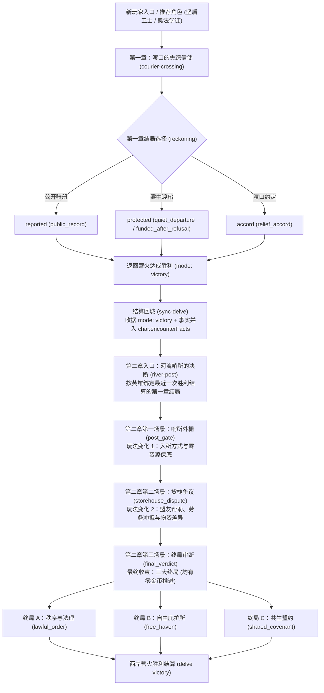

# 1.11.0 样板冒险设计：渡口的失踪信使（第一章）与河湾哨所的决断（第二章）

本文档为 `G:\ai_DND` 1.11.0 候选版本的两章新手样板冒险完整玩法与叙事规格（修订版 01a）。
核心目标：单人约 30 分钟（待真人验证），打磨现有 `guardian`（矮人战士，AC 19，STR 17）与 `arcane`（人类法师，AC 12，INT 17，调查 +7）推荐角色；在无 AI（纯本地引擎裁决）及有 AI（仅辅助叙述）下均能通关；四种历史均具备零资源继续路线；通关后可被作者完整复制与改编。

---

## 一、整体冒险结构与生命周期

### 1.1 章节标识与数据表
- **第一章**：
  - `packId`: `missing-courier`
  - `mapId`: `courier-crossing`（25×15，主题 `hills`）
  - `storyId`: `missing-courier`
  - 核心 NPC：守桥人艾芮（`iris`）、信使里奥（`lio`）
  - 保留原有全部 stable ID 与三结局事实：`public_record`（ending `reported`）、`quiet_departure`（ending `protected`）、`relief_accord`（ending `accord`）。
- **第二章**：
  - `packId`: `missing-courier`
  - `mapId`: `river-post`（25×15，主题 `hills`）
  - `storyId`: `missing-courier-chapter-2`
  - 跨章依赖：`story.requiresHistory: { "storyId": "missing-courier", "fallback": "no_history" }`
  - 核心 NPC：执事官贝伦（`magistrate_beren`）、货栈管事维尔（`storekeeper_vael`）、守哨卫兵奥登（`guard_oden`），并按前章引入艾芮（`iris`）或里奥（`lio`）或难民代表玛拉（`refugee_mara`）。

---

## 二、四种初始历史在第二章的玩法差异与零资源保底矩阵

根据引擎 `engine.js:3354`，选项预检要求 `char.gold >= costGold + failureGold`。若为失败设置了金币代价，0 GP 角色将直接无法选中该选项。
**核心原则：每个必经场景必须至少存在一条 `costGold === 0 && failureGold === 0` 且检定失败仍能推进的合法路线。**

| 初始历史 | 场景 1：哨所外栅 (`post_gate`) | 场景 2：货栈争议 (`storehouse_dispute`) | 场景 3：终局审断 (`final_verdict`) |
|---|---|---|---|
| **reported** (公开交回账册) | **公函免检** (`show_pass`): 0 GP，无需检定，卫兵见名册直接放行。 *零资源保底*：本选项直接免费推进。 | **里奥当面指认** (`cite_records`): 里奥到场作证，说服 DC 10 (0 GP)。 *零资源保底*：检定失败里奥出示手书签字，管事让步推进 (`costGold: 0, failureGold: 0`)。 | **公诉定案** (`choice_lawful_order`): 说服 DC 10 (0 GP)。 *零资源保底*：失败贝伦仍按法理接管，附加公署宵禁条例，达成 `lawful_order` (`costGold: 0`)。 |
| **protected** (渡船秘密送离) | **水门旧道** (`dock_bypass`): 里奥已乘船离开，难民留有水门路线，敏捷 DC 11 (0 GP)。 *零资源保底*：失败被卫兵发现但已入内，扣下登记放行 (`costGold: 0, failureGold: 0`)。 | **难民信物协商** (`refugee_token`): 洞察 DC 11 (0 GP)。或交付水门拾取的药水 (`donate_potion`)。 *零资源保底*：检定失败签署担保保证书开仓 (`costGold: 0, failureGold: 0`)。 | **下游自治** (`choice_free_haven`): 说服 DC 12 (0 GP)。 *零资源保底*：失败贝伦同意撤哨但难民放弃口粮配额，达成 `free_haven` (`costGold: 0`)。 |
| **accord** (协商促成公开救济) | **救济协约令** (`accord_notice`): 0 GP，无需检定，持艾芮预签协约直接开门。 *零资源保底*：本选项直接免费推进。 | **艾芮亲自背书** (`accord_advocacy`): 艾芮在场，免除担保金，说服 DC 11 (0 GP)。 *零资源保底*：失败艾芮签发守桥人暂行令开仓 (`costGold: 0, failureGold: 0`)。 | **签署共生盟约** (`choice_shared_covenant`): 说服 DC 12 (0 GP)。 *零资源保底*：失败贝伦不设新基金但按法理分配现有配额，达成 `lawful_order` (`costGold: 0`)。 |
| **no_history** (无第一章历史) | **陈情申诉** (`persuade_entry`): 说服 DC 12 (0 GP)。或按规缴税 5 GP (`pay_tax`)。 *零资源保底*：说服失败卫兵登记为临时雇工放行 (`costGold: 0, failureGold: 0`)。 | **劳务冲抵清点** (`labor_compromise`): 调查 DC 12 (0 GP)。或垫付 5 GP 押金 (`post_bond`)。 *零资源保底*：调查失败协助搬运面粉换取开仓 (`costGold: 0, failureGold: 0`)。 | **三选项均开放**：`choice_lawful_order` (DC 12), `choice_free_haven` (DC 13), `choice_shared_covenant` (DC 13)。 *零资源保底*：所有选项失败均可达成对应收束或法理结局，均为 0 GP。 |

---

## 三、第二章逐场景详细规格与完整双语文案

### 场景 1：哨所外栅 (`post_gate`)

- **当前目标**：进入河湾哨所。
- **地图坐标与实体**：
  - 守哨卫兵奥登 (`guard_oden`, NPC, 坐标 7,7)
  - 哨所主栅门 (`post_gate_door`, door, 坐标 8,7, locked: true)
  - 哨所前哨强盗守卫 (`post_guard`, monster: bandit, 坐标 10,7)
- **公开信息 (Prompt)**：
  - `zh-CN`: 河湾哨所扼守着通往下游的水道，厚重的木栅门紧闭。守哨卫兵奥登按着腰间的号角：“哨所正在执行戒备，任何闲杂人等不得擅入。”
  - `en`: The River Post commands the bottleneck to the lower river. Its heavy gate is barred. Guard Oden rests a hand on his horn: "The post is on watch. No travelers pass without cause."
- **隐藏信息 (DM 知识)**：
  - 奥登不想惹事。有公函或协约令会立刻开门；无公函时若受到有理有据的陈情，即使未被彻底说服，也会在登记后放行。水门栈桥有巡逻死角。
- **合法选项定义与完整双语文案**：

#### 选项 1.1：`show_pass` (出示调查公函)
- **条件**：`{ "type": "history_ending", "ending": "reported" }`
- **效果**：`{ "type": "passage", "costGold": 0 }`
- **双语文案**：
  - `label`:
    - `zh-CN`: 出示艾芮签署的公诉调查公函
    - `en`: Present Iris's official inquiry pass
  - `response`:
    - `zh-CN`: 奥登核对了文书上的火漆印记，神色缓和下来：“艾芮派来的人？执事官正在主厅等候证词。”他摇动机关打开大门。
    - `en`: Oden checks the wax seal and nods: "Sent by Iris? The magistrate is waiting in the hall." He cranks the winch and opens the gate.
  - `memory`:
    - `zh-CN`: 你出示了公函，守哨卫兵依规放行。
    - `en`: You showed an official pass; the guard opened the gate by regulation.
  - `reactions.guard_oden`:
    - `zh-CN`: 公函齐全，请进。主厅就在里面。
    - `en`: Your papers are in order. The main hall is straight ahead.

#### 选项 1.2：`dock_bypass` (沿水门旧栈道绕行)
- **条件**：`{ "type": "history_ending", "ending": "protected" }`
- **效果**：`{ "type": "check", "skill": "stealth", "dc": 11, "costGold": 0, "failureGold": 0 }`
- **成功**：
  - `fact`: `gate_dock_bypass_success`
  - `label`:
    - `zh-CN`: 依照难民留下的标记，从水门旧栈道潜入
    - `en`: Follow the refugees' trail and slip through the water-gate
  - `response`:
    - `zh-CN`: 你避开正门火把，沿着湿滑的船桩悄然翻过低矮的水门栏杆。哨兵没有察觉你的进入。
    - `en`: Avoiding the torches, you slip over the low water-gate railing along the damp pilings. The sentry notices nothing.
  - `memory`:
    - `zh-CN`: 你借助难民留下的路线潜入了哨所。
    - `en`: You slipped into the post using the refugees' path.
- **失败推进** (`failure`)：
  - `fact`: `gate_dock_bypass_seen`
  - `response`:
    - `zh-CN`: 水门的旧木板发出脆响。奥登转过身发现你，皱起眉头：“走水门进来的？算了，今天不查私货，登记名字就进去吧。”大门由此打开。
    - `en`: A rotting board creaks underfoot. Oden turns and frowns: "Coming by the slipway? No contraband checks today. Sign the roll and step inside." The gate opens.
  - `memory`:
    - `zh-CN`: 你在水门被发觉，但卫兵登记后准许通行。
    - `en`: Spotted at the water-gate, but the guard signed you through.

#### 选项 1.3：`accord_notice` (出示救济协约令)
- **条件**：`{ "type": "history_ending", "ending": "accord" }`
- **效果**：`{ "type": "passage", "costGold": 0 }`
- **双语文案**：
  - `label`:
    - `zh-CN`: 出示渡口救济协约初审文书
    - `en`: Present the Crossing Accord notice
  - `response`:
    - `zh-CN`: 奥登双手接过文书：“原来是渡口送来的救济协约！艾芮早前已传信过来，快请进。”大门随即敞开。
    - `en`: Oden receives the paper with both hands: "The relief accord from the crossing! Iris sent word ahead. Enter freely." The gate swings open.
  - `memory`:
    - `zh-CN`: 救济协约文书为你赢得了免检通行。
    - `en`: The relief accord granted you free passage.

#### 选项 1.4：`persuade_entry` (说明来意，请求放行)
- **条件**：`{ "type": "always" }`
- **效果**：`{ "type": "check", "skill": "persuasion", "dc": 12, "costGold": 0, "failureGold": 0 }`
- **成功**：
  - `fact`: `gate_persuaded`
  - `label`:
    - `zh-CN`: 说明渡口变故，恳请放行通报
    - `en`: Explain the crossing's crisis and ask for entry
  - `response`:
    - `zh-CN`: 奥登被你的诚意打动：“找执事官谈公事是合理的。进去吧，别在院里随意走动。”大门开启。
    - `en`: Oden is swayed by your earnest words: "Business with the magistrate is lawful enough. Go in, but cause no trouble." The gate opens.
  - `memory`:
    - `zh-CN`: 你说服了奥登为你打开哨所大门。
    - `en`: You persuaded Oden to open the gate.
- **失败推进** (`failure`)：
  - `fact`: `gate_probation_entry`
  - `response`:
    - `zh-CN`: 奥登摇头：“规矩不能坏。不过看在事态紧急的份上，我扣下你的名字作为临时登记，限时出来见执事官。”大门仍旧为你开启。
    - `en`: Oden shakes his head: "Rules are rules. Still, given the urgency, I'll enter your name as a provisional guest. See the magistrate at once." The gate opens anyway.
  - `memory`:
    - `zh-CN`: 说服虽未完全成功，但卫兵临时登记后放行。
    - `en`: The appeal was imperfect, but the guard granted provisional passage.

#### 选项 1.5：`pay_tax` (缴纳五金币通行税)
- **条件**：`{ "type": "always" }`
- **效果**：`{ "type": "passage", "costGold": 5 }`
- **双语文案**：
  - `label`:
    - `zh-CN`: 缴纳五枚金币哨所通行税
    - `en`: Pay the five gold post transit tax
  - `response`:
    - `zh-CN`: 你交付五枚金币。奥登收下钱币并盖章：“通行税已结清。哨所内禁止拔刀。”大门打开。
    - `en`: You pay five gold. Oden takes the coins and stamps the book: "Toll settled. Keep your blades sheathed inside." The gate opens.
  - `memory`:
    - `zh-CN`: 你支付了五枚金币通行税。
    - `en`: You paid the five gold transit tax.

#### 选项 1.6：`fight_gate` (武力闯门)
- **条件**：`{ "type": "always" }`
- **效果**：`{ "type": "combat" }`（与守卫 `post_guard` 交战）
- **双语文案**：
  - `label`:
    - `zh-CN`: 拔剑强攻，击倒哨卡守卫
    - `en`: Draw steel and force your way past the sentry
  - `response`:
    - `zh-CN`: 前哨守卫被击倒，奥登退回哨楼拉起警报门栓。木栅门在混乱中被撞开，通路打开。
    - `en`: The sentry falls. Oden retreats to the watchbox to blow his horn. In the confusion the gate yields.
  - `memory`:
    - `zh-CN`: 你击倒了哨卡守卫强行过门。
    - `en`: You forced your way past the sentry.

- **下个目标**：前往货栈大厅 (`storehouse_dispute`)。
- **教学提示 (Tutorial Hint)**：
  - `title`: `ui.tutorial.choices_and_fails` ("检定与保底推进" / "Checks and Safe Progress")
  - `text`: `ui.tutorial.choices_and_fails_text` ("D&D 探索中检定失败并不代表游戏结束。许多选项即便骰点未达 DC，也会以让步或附带条件的形式推进剧情。" / "In D&D delves, a failed check rarely means game over. Many choices fail forward with narrative concessions.")

---

### 场景 2：货栈争议 (`storehouse_dispute`)

- **前置**：`requiresScene: "post_gate"`
- **当前目标**：解决粮秣货栈被锁争议，获得进入议事大厅的许可与证据。
- **地图坐标与实体**：
  - 货栈管事维尔 (`storekeeper_vael`, NPC, 坐标 14,7)
  - 仓储大门 (`storehouse_door`, door, 坐标 15,7, locked: true)
  - 难民代表玛拉 (`refugee_mara`, NPC, 坐标 13,8；当且仅当前章为 `protected` 时出现)
  - 艾芮 (`iris`, NPC, 坐标 13,6；当且仅当前章为 `accord` 时出现)
  - 里奥 (`lio`, NPC, 坐标 14,8；当且仅当前章为 `reported` 时出现)
  - 水门物资箱 (`dock_cache`, chest, 坐标 3,12；前章为 `protected` 时拾取获得 1 瓶 `potion_healing`)
- **公开信息 (Prompt)**：
  - `zh-CN`: 货栈前聚集着争执的人群。管事维尔把守着厚铁锁：“没有批条或足额押金，这里的任何一袋救济粮、一瓶药水都休想运出去！”
  - `en`: An uneasy crowd gathers at the warehouse. Storekeeper Vael guards the padlock: "Without written warrants or a deposit, not one sack of grain or bottle of medicine leaves this depot!"
- **隐藏信息 (DM 知识)**：
  - 维尔克扣了部分仓储自肥，害怕正规核账。如果有人拿出对账凭据或自愿承担杂务劳工，他会借坡下驴。
- **合法选项定义与完整双语文案**：

#### 选项 2.1：`cite_records` (由里奥出面出示原底账)
- **条件**：`{ "type": "history_ending", "ending": "reported" }`
- **效果**：`{ "type": "check", "skill": "persuasion", "dc": 10, "costGold": 0, "failureGold": 0 }`
- **成功**：
  - `fact`: `dispute_lio_testimony`
  - `label`:
    - `zh-CN`: 让里奥当面指出账册上的出入
    - `en`: Have Lio point out the ledger discrepancies in person
  - `response`:
    - `zh-CN`: 里奥上前摊开渡口账册底本。维尔额头冒汗，仓皇收起私账：“原来是公署的证人！仓门开了，请尽管调阅。”
    - `en`: Lio presents the original crossing ledger. Sweating, Vael hides his private notes: "The council's own witness! The doors are open; inspect at will."
  - `memory`:
    - `zh-CN`: 里奥的当面指认让货栈管事迅速屈服。
    - `en`: Lio's direct testimony quickly made the storekeeper yield.
- **失败推进** (`failure`)：
  - `fact`: `dispute_lio_signature_concession`
  - `response`:
    - `zh-CN`: 维尔试图狡辩，里奥直接指出自己的手书签字。维尔不敢公然对抗公署证据，骂骂咧咧地解开锁链：“算你们厉害，进来吧。”
    - `en`: Vael attempts to bluster, but Lio taps his own clerk signature. Unwilling to defy written evidence, Vael unchains the gate: "Have it your way. Get inside."
  - `memory`:
    - `zh-CN`: 账册签字迫使管事开门，维尔心怀怨气。
    - `en`: The clerk's signature forced Vael to yield, though he grumbled bitterly.

#### 选项 2.2：`refugee_token` (出示难民长者信物)
- **条件**：`{ "type": "history_ending", "ending": "protected" }`
- **效果**：`{ "type": "check", "skill": "insight", "dc": 11, "costGold": 0, "failureGold": 0 }`
- **成功**：
  - `fact`: `dispute_token_accepted`
  - `label`:
    - `zh-CN`: 出示难民玛拉留存的渡工信物，指明仓储调配权
    - `en`: Show Elder Mara's ferry token to negotiate emergency grain
  - `response`:
    - `zh-CN`: 玛拉上前的作证与信物让维尔意识到这批难民已有妥善安排：“只要别说是我擅自放的粮就行。”他打开库门。
    - `en`: Mara's token and testimony convince Vael the refugees have arranged departure: "Just don't claim I gave it away freely." He unlocks the gate.
  - `memory`:
    - `zh-CN`: 难民信物说服了管事通融放粮。
    - `en`: The refugee token persuaded Vael to release supplies.
- **失败推进** (`failure`)：
  - `fact`: `dispute_guarantor_pledge`
  - `response`:
    - `zh-CN`: 维尔不认信物，但害怕激起民愤：“你在调拨单上签下冒险者担保，出了差错议会找你算账！”你签署担保，仓门开启。
    - `en`: Vael dismisses the token, but fears unrest: "Sign as the adventurers' guarantor! If the council audits, it's on your head." You sign; the door opens.
  - `memory`:
    - `zh-CN`: 你以个人名义签署担保，换得仓门开启。
    - `en`: You signed as guarantor to open the warehouse.

#### 选项 2.3：`accord_advocacy` (由艾芮作为守桥人当场背书)
- **条件**：`{ "type": "history_ending", "ending": "accord" }`
- **效果**：`{ "type": "check", "skill": "persuasion", "dc": 11, "costGold": 0, "failureGold": 0 }`
- **成功**：
  - `fact`: `dispute_accord_advocacy`
  - `label`:
    - `zh-CN`: 由艾芮出示渡口协约，以公职身份命令开仓
    - `en`: Have Iris cite the Crossing Accord and order the doors opened
  - `response`:
    - `zh-CN`: 艾芮按剑而立，掷地有声。维尔不敢违抗守桥人的公署威望，老老实实取出钥匙开门。
    - `en`: Iris rests her hand on her pommel, her voice ringing clear. Vael dares not defy her lawful standing and unlocks the warehouse.
  - `memory`:
    - `zh-CN`: 艾芮的公署威信使货栈管事顺服。
    - `en`: Iris's lawful authority compelled the storekeeper to comply.
- **失败推进** (`failure`)：
  - `fact`: `dispute_bridgewarden_order`
  - `response`:
    - `zh-CN`: 维尔推三阻四，艾芮直接签发一份暂行调令压在柜台上：“责任由我承担。”维尔无奈打开仓门。
    - `en`: Vael hedges, but Iris signs a provisional requisition and slaps it down: "I take full responsibility." Vael reluctantly turns the key.
  - `memory`:
    - `zh-CN`: 艾芮签发暂行令平息争议。
    - `en`: Iris issued a provisional order to resolve the dispute.

#### 选项 2.4：`labor_compromise` (主动协助清点账目与杂役)
- **条件**：`{ "type": "always" }`
- **效果**：`{ "type": "check", "skill": "investigation", "dc": 12, "costGold": 0, "failureGold": 0 }`
- **成功**：
  - `fact`: `dispute_investigated_errors`
  - `label`:
    - `zh-CN`: 协助核对仓储底账，找出多余的富余定额
    - `en`: Audit the storehouse tally to find surplus rations
  - `response`:
    - `zh-CN`: 你敏锐地核对了三车谷物与防霉记录，挑出了维尔算错的盈余份额。维尔大喜：“算你帮了大忙！”他痛快地打开仓门。
    - `en`: Examining the grain logs and spoilage records, you spot surplus sacks hidden in math errors. Delighted, Vael grins: "You saved my neck!" He unlocks the doors.
  - `memory`:
    - `zh-CN`: 你通过精湛的调查核平了账目盈余，换得开门。
    - `en`: Your thorough investigation uncovered surplus grain and opened the doors.
- **失败推进** (`failure`)：
  - `fact`: `dispute_labor_concession`
  - `response`:
    - `zh-CN`: 账目过于杂乱难以厘清，但你卷起袖子帮搬运工扛完了积压的面粉袋。维尔擦擦汗：“看在你出力干活的份上，放你们进去。”仓门开启。
    - `en`: The messy tallies yield no quick answers, but you haul heavy flour sacks alongside the workers. Wiping his brow, Vael sighs: "Honest labor earns its keep. Step inside."
  - `memory`:
    - `zh-CN`: 账目未清，但诚实的体力协助换来了放行。
    - `en`: The audit failed, but honest physical labor secured passage.

#### 选项 2.5：`post_bond` (自掏腰包垫付五金币杂费押金)
- **条件**：`{ "type": "always" }`
- **效果**：`{ "type": "decision", "costGold": 5 }`
- **双语文案**：
  - `label`:
    - `zh-CN`: 垫付五枚金币仓储担保金
    - `en`: Pay a five gold storage deposit
  - `response`:
    - `zh-CN`: 维尔数清五枚金币，锁上钱箱：“有押金就好办。仓门归你们了。”
    - `en`: Vael counts five gold and pockets them: "A proper deposit speaks clearly. The warehouse is yours."
  - `memory`:
    - `zh-CN`: 你支付了五枚金币仓储押金。
    - `en`: You paid a five gold storage deposit.

- **下个目标**：进入议事主厅，面见执事官贝伦，参与终审裁决 (`final_verdict`)。

---

### 场景 3：终局审断 (`final_verdict`)

- **前置**：`requiresScene: "storehouse_dispute"`
- **当前目标**：面见执事官贝伦，定夺河湾终审方案。
- **地图坐标与实体**：
  - 执事官贝伦 (`magistrate_beren`, NPC, 坐标 21,7)
  - 终审案卷书台 (`verdict_desk`, object, 坐标 20,7)
- **公开信息 (Prompt)**：
  - `zh-CN`: 执事官贝伦端坐在长桌尽头，桌上摊着渡口账册、难民名册与哨所印章。“信使、账册、过桥税，还有下游那些无家可归的人。今天必须有个交代。你一路见证至此，议会听取你的裁决。”
  - `en`: Magistrate Beren sits at the long table surrounded by ledgers, refugee rolls, and official seals. "The courier, the missing tolls, and the destitute families downstream. This ends today. You witnessed it all; the council hears your verdict."
- **隐藏信息 (DM 知识)**：
  - 贝伦并非酷吏，他关注的是法理、秩序与民生平衡。无论玩家偏向哪种立场，只要逻辑自洽，他都愿意盖印签署。
- **三大终局选项定义与完整双语文案**：

#### 选项 3.1：`choice_lawful_order` (秩序与法理 · 设立公署审计与劳役归档)
- **条件**：`{ "type": "always" }`
- **效果**：`{ "type": "check", "skill": "persuasion", "dc": 12, "costGold": 0, "failureGold": 0 }`
- **成功**：
  - `ending`: `lawful_order`
  - `fact`: `verdict_lawful_order`
  - `label`:
    - `zh-CN`: 裁定法理优先：账目移交议会公署，难民登记编入合法劳役名册
    - `en`: Rule by Law: Transfer records to the council; register refugees for lawful work
  - `response`:
    - `zh-CN`: 结局：秩序与法理。贝伦郑重盖上哨所朱印。渡口账册被正式归档，里奥获得赦免并转任公署登记官；难民家庭获得了合法的定居配额与劳役生计。程序正义得以彰显，瓦尔谷的税法尊严得以保全。返回西岸营火完成冒险。
    - `en`: Ending: Lawful Order. Beren stamps the decree. The crossing ledger is formally archived; Lio is pardoned to serve as a registry clerk, and the families receive lawful settlement permits. Due process is upheld, preserving the rule of law. Return to the west-bank campfire to finish.
  - `memory`:
    - `zh-CN`: 你促成了法理解决：公署接管账目，难民获准合法登记定居。
    - `en`: You secured a lawful resolution: the council archived the ledger and granted lawful settlement.
- **失败推进** (`failure`)：
  - `ending`: `lawful_order`
  - `fact`: `verdict_lawful_strict_oversight`
  - `response`:
    - `zh-CN`: 结局：秩序与法理。贝伦接受了归档提案，但追加了严苛的宵禁与定期考查条款：“议会的宽容绝非无度。”尽管受到管制，难民仍免于流离失所。返回西岸营火完成冒险。
    - `en`: Ending: Lawful Order. Beren accepts the petition but adds strict curfews: "The council's mercy carries strict bounds." Though heavily regulated, the families are spared displacement. Return to the west-bank campfire to finish.
  - `memory`:
    - `zh-CN`: 公署接管了账册，但附加了严格的管理条例。
    - `en`: The council archived the records under strict administrative oversight.

#### 选项 3.2：`choice_free_haven` (自由庇护所 · 划定河湾下游自治安置)
- **条件**：`{ "type": "always" }`
- **效果**：`{ "type": "check", "skill": "persuasion", "dc": 12, "costGold": 0, "failureGold": 0 }`
- **成功**：
  - `ending`: `free_haven`
  - `fact`: `verdict_free_haven`
  - `label`:
    - `zh-CN`: 裁定人道庇护：哨所撤回追捕，河湾下游划归难民自由开垦自治
    - `en`: Rule by Sanctuary: Withdraw patrols and grant the lower riverway as an autonomous haven
  - `response`:
    - `zh-CN`: 结局：自由庇护所。贝伦在地图上圈出下游河湾：“公署巡逻队将止步于哨所渡口，追逃令即刻撤销。”难民们得以在下游建立属于自己的自由聚落，两地以河运贸易互惠互利。返回西岸营火完成冒险。
    - `en`: Ending: A River Haven. Beren circles the lower banks on the map: "Patrols will halt at the post. All warrants are rescinded." The families gain autonomous land to build a peaceful haven, trading with the town by riverboat. Return to the west-bank campfire to finish.
  - `memory`:
    - `zh-CN`: 你为难民争取到了河湾下游的自由自治权。
    - `en`: You won the refugees autonomy in the lower river haven.
- **失败推进** (`failure`)：
  - `ending`: `free_haven`
  - `fact`: `verdict_free_haven_conditional`
  - `response`:
    - `zh-CN`: 结局：自由庇护所。贝伦同意停止追捕并划界自治，但他要求难民签署放弃申领镇内救济粮的誓约。难民获得了安全与自由，但未来的口粮需全凭自己的双手耕作。返回西岸营火完成冒险。
    - `en`: Ending: A River Haven. Beren agrees to stop pursuit and yield the land, but demands the refugees renounce all claims to town rations. They have freedom and safety, but must sustain themselves entirely. Return to the west-bank campfire to finish.
  - `memory`:
    - `zh-CN`: 下游自治达成，难民以放弃镇内救济为代价换取了人身自由。
    - `en`: Sanctuary was won downstream, traded against town welfare claims.

#### 选项 3.3：`choice_shared_covenant` (共生盟约 · 固定抽取 10% 渡税设立长效基金)
- **条件**：`{ "type": "always" }`
- **效果**：`{ "type": "check", "skill": "persuasion", "dc": 13, "costGold": 0, "failureGold": 0 }`
- **成功**：
  - `ending`: `shared_covenant`
  - `fact`: `verdict_shared_covenant`
  - `label`:
    - `zh-CN`: 裁定长效共生：过桥税永久划拨一成设立救济金，由守桥人共管
    - `en`: Rule by Covenant: Permanently divert ten percent of bridge tolls into a joint relief fund
  - `response`:
    - `zh-CN`: 结局：共生盟约。各方代表共同在盟约卷轴上签名。过桥税款不再被私下挪用，而是依法提取一成注入瓦尔谷行路人救济基金，由守桥人艾芮公正监管。仁慈与法理融为一体。返回西岸营火完成冒险。
    - `en`: Ending: The Sunlit Covenant. All parties sign the covenant scroll. Bridge tolls are no longer diverted in secret; ten percent is lawfully dedicated to a traveler relief fund overseen by Bridgewarden Iris. Mercy and justice become one. Return to the west-bank campfire to finish.
  - `memory`:
    - `zh-CN`: 你促成了三方共生盟约：过桥税一成永久用于公开救济。
    - `en`: You forged a lasting covenant: ten percent of tolls now fund public relief lawfully.
- **失败推进** (`failure`)：
  - `ending`: `lawful_order`
  - `fact`: `verdict_covenant_fallback_law`
  - `response`:
    - `zh-CN`: 结局：秩序与法理。贝伦摇头表示无法代表镇议会分割永久税源，但他认可账目公布的意义，决定将案卷按正规听证接管。盟约未立，但法理归位。返回西岸营火完成冒险。
    - `en`: Ending: Lawful Order. Beren cannot bind the council to permanent tax-sharing, but accepts the transparent ledger. He takes over the case under formal council procedures. The covenant fell short, yet lawful order prevails. Return to the west-bank campfire to finish.
  - `memory`:
    - `zh-CN`: 共生盟约未获全准，案件转由公署按常规法理归档。
    - `en`: The permanent covenant fell short; the case defaulted to council legal oversight.

---

## 四、推荐英雄针对性数值与体验打磨（与源码精确对照）

### 4.1 坚盾卫士 (Guardian · 矮人战士)
- **实际属性（源码与集成测试断言）**：
  - 等级 1，矮人战士 (`dwarf`, `fighter`)；
  - 属性：STR 17 (+3), DEX 14 (+2), CON 14 (+2), INT 12 (+1), WIS 10 (+0), CHA 8 (-1)；
  - 防御与血量：**AC 19**（板条甲/锁子甲 16 + 盾牌 2 + 防御战斗风格 1 = 19），**HP max 13**；
  - 武器攻击：长剑 (+5 命中，1d8+3 伤害)；
  - 核心特性：Second Wind（附赠动作恢复 1d10+1 HP）。
- **实战流程打磨**：
  - 面对正门守卫战斗 (`fight_gate`)，19 AC 让普通强盗（命中 +3）命中率仅 25%，战士能稳定承伤；
  - 即使说服检定（魅力 -1）掷骰失利，所有场景的失败保底选项均零金币推进，战士绝不卡关。

### 4.2 奥法学徒 (Arcane · 人类法师)
- **实际属性（源码与集成测试断言）**：
  - 等级 1，人类法师 (`human`, `wizard`)；
  - 属性：STR 8 (-1), DEX 14 (+2), CON 14 (+2), INT 17 (+3), WIS 12 (+1), CHA 10 (+0)；
  - 防御与血量：**AC 12**（10 + DEX 2），**HP max 8**；
  - 核心技能：**调查 (Investigation) +7**（智力 +3 + 熟练 +2 + 法师专精 +2 = +7）；洞察 (Insight) +3；
  - 施法能力：法术攻击 +5，法术豁免 DC 13；戏法 Fire Bolt (1d10, 射程 12 格)、Ray of Frost；法术位：2 个 1 环法术位（Magic Missile、Shield 等）。
- **实战流程打磨**：
  - 戏法 Fire Bolt 拥有无限次使用次数；法术位耗尽时远程火力依然稳定；
  - 极高调查加值 (+7) 使其在货栈核算 (`labor_compromise`) 中拥有高达 80% 的成功率；
  - 社交检定（魅力 +0）虽非极高，但零资源保底机制确保其即使失败也能安全平稳通关。

---

## 五、无第一章历史直入说明

当玩家直接选择第二章出征（如在冒险目录中直接挑选）或使用未完成第一章的英雄时：
- **目录与准备页提示文案**：
  - `zh-CN`: “《河湾哨所的决断》承接《渡口的失踪信使》。检测到该英雄尚未完成第一章探索，哨所守卫将按照中立旅人程序接洽（无前章特殊信物或指认，但全部三条解决路线均可正常完成）。你也可以先完成第一章以继承真实选择。”
  - `en`: "'The River Post Verdict' follows 'The Missing Courier'. No completed Chapter 1 record was found for this hero; the post guards will receive you under standard traveler procedures. All three resolutions remain fully open. You may also complete Chapter 1 first to carry your choices forward."
